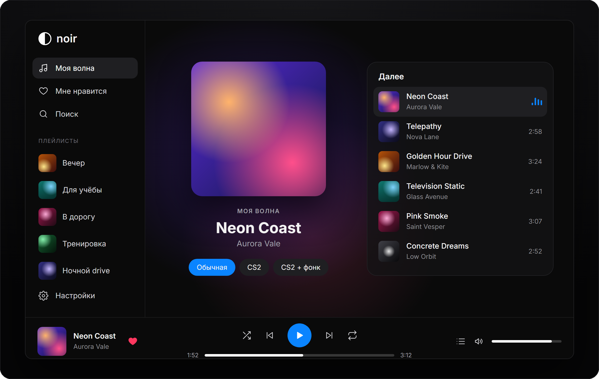

<div align="center">

# Noir

**Чёрно-белый музыкальный плеер для Windows 11**

Яндекс Музыка и SoundCloud без Electron: быстрее, легче, тише.

[](https://github.com/trualontuu/player/releases/latest/download/Noir.zip)
&nbsp;
[](https://github.com/trualontuu/noir-ios)


[](https://github.com/trualontuu/player/releases/latest)



<sub>Макет: треки и обложки выдуманные.</sub>

</div>

## Установка

> Нужна Windows 11 (64-бит). Ставить .NET не нужно — всё уже внутри.

1. Скачай **[Noir.zip](https://github.com/trualontuu/player/releases/latest/download/Noir.zip)** и распакуй в папку

   ```
   %LOCALAPPDATA%\Programs\Player
   ```

   (вставь эту строку в адресную строку Проводника). Подойдёт и любая другая папка, но по этому пути плеер находит [Launcher](https://github.com/trualontuu/launcher) для команд «пауза», «волна» и поиска музыки.
2. Запусти `Player.exe`.
3. Нажми «Войти через Яндекс» — откроется **ya.ru/device**, введи там код из окна плеера. Пароль Noir не видит, токен хранится только у тебя на компьютере.
4. Готово: включай «Мою волну». Автозапуск с Windows — в настройках.

<details>
<summary><b>Windows пишет «Windows защитила ваш компьютер»</b></summary>

Это из-за того, что программа не подписана платным сертификатом. Нажми **«Подробнее» → «Выполнить в любом случае»**. Окно появляется только при первом запуске.
</details>

<details>
<summary><b>Как управлять с телефона</b></summary>

Поставь [Noir для iPhone](https://github.com/trualontuu/noir-ios) и войди тем же аккаунтом Яндекса. Пока Noir открыт на компьютере, в приложении на телефоне появится карточка «Играет на компьютере» — оттуда можно ставить паузу, листать треки, лайкать, перематывать и менять громкость (в том числе кнопками громкости айфона). Работает и через мобильный интернет.
</details>

<details>
<summary><b>Как удалить</b></summary>

Выключи автозапуск в настройках, закрой плеер и удали папку. Настройки лежат в `%APPDATA%\Player`, кэш обложек — в `%LOCALAPPDATA%\Player`.
</details>

## Что умеет

| | |
|---|---|
| 🌊 **Моя волна** | настройка характера и настроения, **режим CS2**: при запуске игры волна сама переключается на хайп-трэп; стоп-лист артистов |
| 💿 **Вся медиатека** | лайки, плейлисты, поиск, страницы артистов и альбомов, очередь «Далее» с перетаскиванием |
| ☁️ **SoundCloud** | поиск, артисты, плейлисты, «станция» по треку (только открытые потоки, треки с DRM не играют) |
| 📱 **Пульт с телефона** | [Noir для iPhone](https://github.com/trualontuu/noir-ios) управляет плеером, как Spotify Connect |
| 🔊 **Ровная громкость** | выравнивание по EBU R128 (LUFS) — треки не скачут по уровню |
| ⌨️ **Часть системы** | медиаклавиши, карточка в [Island](https://github.com/trualontuu/island) и в панели громкости Windows; <kbd>Ctrl</kbd>+<kbd>Alt</kbd>+<kbd>←</kbd><kbd>→</kbd><kbd>↑</kbd><kbd>↓</kbd> |
| 🎨 **Цвета** | строгий ч/б, тема Island или тон текущей обложки |
| 🪶 **Лёгкий** | ~59 МБ памяти, 0% процессора в простое, трек стартует за ~0,4 с |

### Горячие клавиши

| | |
|---|---|
| <kbd>Ctrl</kbd>+<kbd>Alt</kbd>+<kbd>←</kbd> / <kbd>→</kbd> | предыдущий / следующий трек |
| <kbd>Ctrl</kbd>+<kbd>Alt</kbd>+<kbd>↓</kbd> | пауза |
| <kbd>Ctrl</kbd>+<kbd>Alt</kbd>+<kbd>↑</kbd> | лайк |
| медиаклавиши | пауза и треки, как в любом плеере |

Сочетания работают и в играх, их можно поменять в настройках.

## Для разработчиков

<details>
<summary><b>Сборка из исходников</b></summary>

Нужен [.NET 10 SDK](https://dotnet.microsoft.com/download). Часть кода общая с [Island](https://github.com/trualontuu/island) — файлы подключаются ссылками из соседней папки, поэтому оба репозитория должны лежать рядом:

```
projects/
  island/   ← trualontuu/island
  player/   ← этот репозиторий
```

```
git clone https://github.com/trualontuu/island
git clone https://github.com/trualontuu/player
cd player
dotnet publish -c Release -o dist
```

Проверка без окна: `Player.exe --snap <папка> [--play]` — снимки всех страниц и `report.txt` с замерами; `--play` включает волну на громкости 0 и без отзывов в аккаунт.

Звук идёт через `Windows.Media.Playback.MediaPlayer` и SMTC, поэтому система видит Noir как обычный плеер. Пульт — WebSocket к ретранслятору [Noir Connect](https://github.com/trualontuu/noir-ios/tree/main/connect) на Cloudflare Workers.
</details>

---

<div align="center"><sub>Noir — неофициальный клиент. Он не связан с Яндексом или SoundCloud и не обходит защиту контента.</sub></div>
